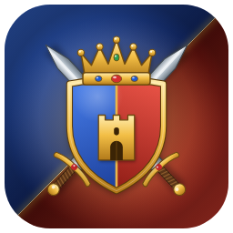
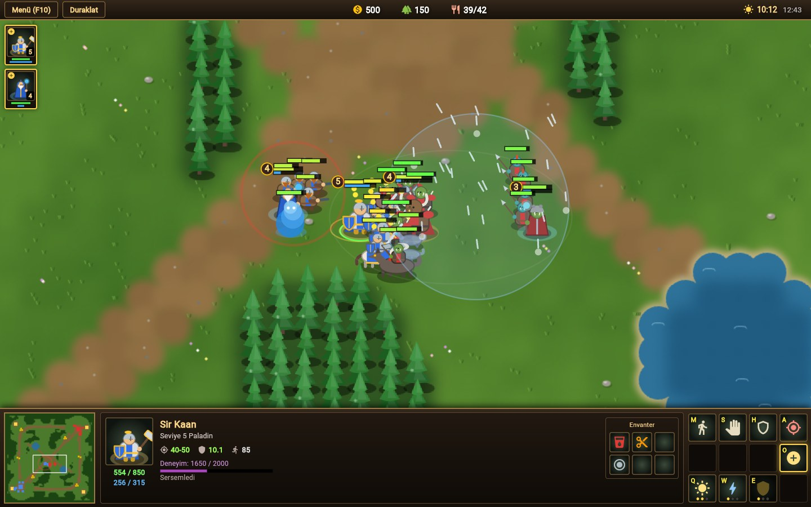
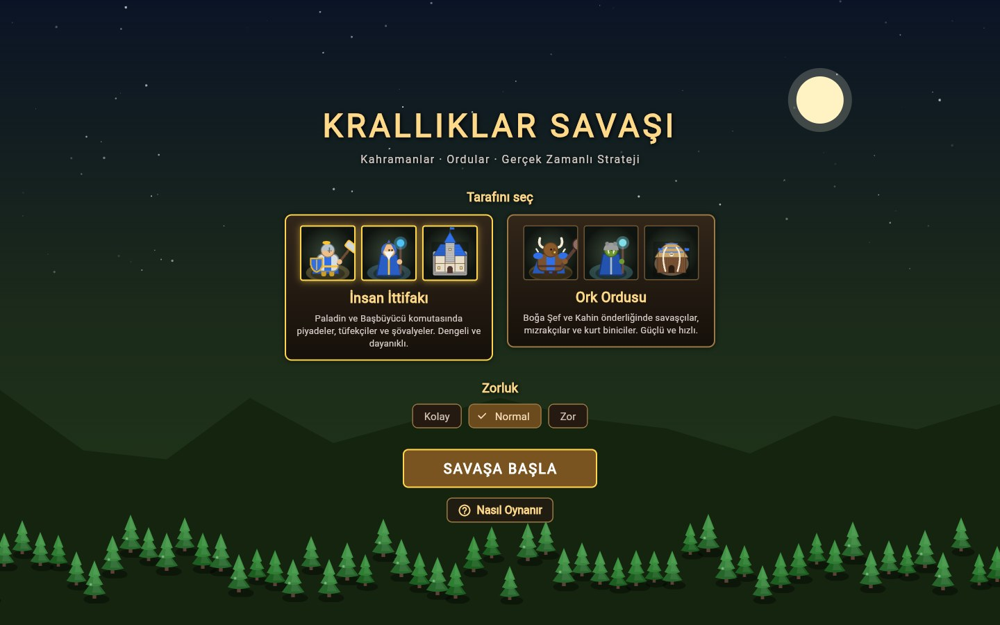
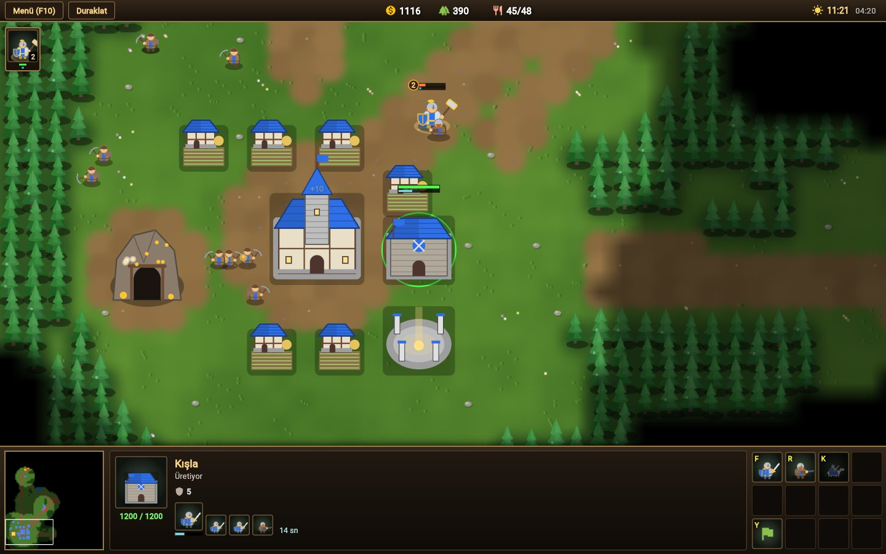
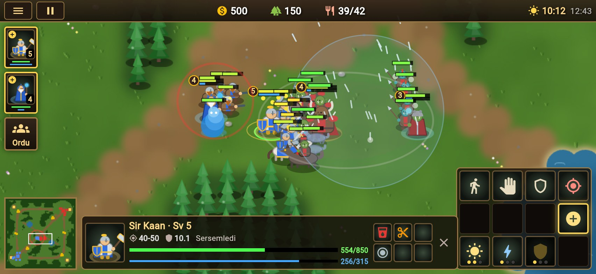
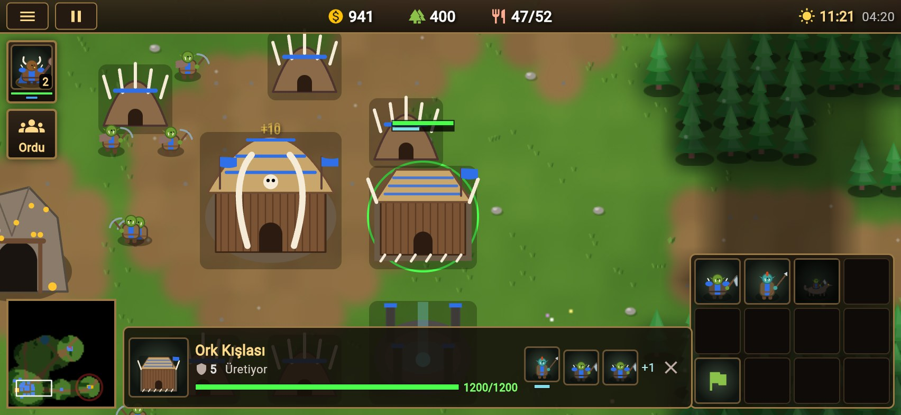

<p align="center"></p>

# War of Kingdoms

Kahramanların ve orduların çarpıştığı, Flutter ile yazılmış gerçek zamanlı strateji oyunu. Tüm grafikler
kodla (prosedürel olarak) çizilir; harici görsel ya da paket gerekmez.



## Ekran görüntüleri

### Masaüstü

| Ana menü | Üs ve üretim |
| --- | --- |
|  |  |
| Taraf ve zorluk seçimi, "Nasıl Oynanır" ekranı | Altın madeni, çiftlikler, kışla ve sunak; seçili kışlanın üretim sırası ve komut kartı |

### Telefon (yatay)

| Savaş | Ork üssü |
| --- | --- |
|  |  |
| Kahraman seçiliyken can/mana, envanter ve yetenekler | Sol sütunda kahraman ve "Ordu" düğmesi, altta seçim şeridi |

## Çalıştırma

### Gereksinimler

- **Flutter 3.47 veya üstü** (Dart 3.13+). Sürümünü `flutter --version` ile görebilir, gerekirse
  `flutter upgrade` ile güncelleyebilirsin. Daha eski sürümlerde `flutter pub get` sürüm hatası verir.
- iOS ve macOS için Xcode, Android için Android SDK (Android Studio), web için Chrome.

### Kurulum

```bash
git clone https://github.com/hincim/War-of-Kingdoms.git
cd War-of-Kingdoms
flutter pub get
```

### Başlatma

```bash
flutter run -d macos     # masaüstü
flutter run -d chrome    # tarayıcı
flutter run              # bağlı telefon / simülatör (iOS, Android)
```

Proje macOS, iOS, Android ve web için derlenip denendi; Windows ve Linux sürümleri henüz denenmedi.

Büyük ekranlarda fare ve klavye için tasarlanmış masaüstü arayüzü, telefonlarda (ya da 1000×620'den küçük
pencerelerde) dokunmatik için ayrı bir arayüz açılır. Telefonda oyun yalnızca yatay ve tam ekran çalışır.

## Oyun

- **İki taraf:** İnsan İttifakı ve Ork Ordusu. Rakip bilgisayar diğer tarafı oynar.
- **Kaynaklar:** İşçiler altın madeninden altın, ağaçlardan odun toplar. Çiftlik / Barınak yiyecek sınırını artırır.
- **Yapılar:** Ana Bina, Çiftlik, Kışla, Sunak, Demirci / Savaş Değirmeni, Gözcü Kulesi.
- **Birimler:** Piyade, Tüfekçi, Şövalye / Savaşçı, Mızrakçı, Kurt Binici.
- **Kahramanlar:** Paladin, Başbüyücü / Boğa Şef, Kahin. Seviye atlar (en fazla 10), üçer yetenek
  öğrenir, 6 yuvalı envanter taşır. Ölen kahraman sunakta diriltilir.
- **Tarafsız yaratıklar:** Haritadaki kamplar deneyim, altın ve eşya (iksir, yüzük, çizme, kitap…) verir.
- **Sis ve gece:** Görülmemiş alanlar karanlıktır; gece görüş mesafesi azalır.
- **Yapay zekâ:** Ekonomi kurar, kamp temizler, genişler ve dalgalar halinde saldırır (Kolay / Normal / Zor).
- **Amaç:** Düşmanın tüm yapılarını yıkmak.

## Kontroller

| Girdi | İşlev |
| --- | --- |
| Sol tık / sürükle | Seç / kutu seçimi (Shift: ekle, çift tık: aynı türdekiler) |
| Sağ tık | Akıllı emir: hareket, saldırı, toplama, eşya alma, toplanma noktası |
| A, S, H, M | Saldır, dur, pozisyonu koru, hareket |
| B, G | İnşa menüsü, topla (işçi) |
| Q, W, E / O | Kahraman yetenekleri / yetenek öğren |
| Ctrl+1–9, 1–9 | Kontrol grubu ata / seç (iki kez: kamerayı götür) |
| F1, F2, F8 | Kahramanlar, boştaki işçi |
| Ok tuşları, ekran kenarı, orta tuş, iki parmak | Kamera |
| Tekerlek | Yakınlaştır |
| Boşluk | Son saldırı uyarısına git |
| Alt | Tüm can çubukları |
| Esc / F10 | İptal / menü |

## Dokunmatik kontroller (telefon)

| Hareket | İşlev |
| --- | --- |
| Birime dokun | Seç |
| Seçiliyken yere / düşmana / madene / ağaca dokun | Hareket / saldırı / altın / odun |
| Çift dokun ya da basılı tut | Ekrandaki aynı türden birimleri seç |
| Basılı tut + sürükle | Kutu seçimi |
| Tek parmakla kaydır | Kamera |
| İki parmak | Yakınlaştır / uzaklaştır |
| Sol sütun | Kahramanlar, boştaki işçi, **Ordu** (tüm askerleri seç) |
| Şeritteki ✕ | Seçimi kaldır |
| İnşa | Yapıyı seç → yere dokun ya da parmakla sürükleyip ✓ ile onayla |

## Kod yapısı

```
lib/
  main.dart               ana menü
  game/data.dart          birim, yapı, yetenek, eşya ve harita tanımları
  game/map.dart           harita üretimi ve A* yol bulma
  game/entities.dart      birim, oyuncu, mermi ve efekt sınıfları
  game/game.dart          simülasyon: emirler, savaş, toplama, inşa, yetenekler, sis
  game/ai.dart            bilgisayar rakibi
  render/sprites.dart     prosedürel çizimler
  render/logo.dart        oyun logosu (menü ve uygulama simgeleri)
  render/world_painter.dart  dünya çizimi (arazi önbelleği, sis, efektler)
  ui/controller.dart      seçim, komut kartı, kısayollar
  ui/hud.dart             masaüstü arayüzü: üst çubuk, mini harita, bilgi paneli, komut kartı
  ui/mobile_hud.dart      telefon arayüzü
  ui/game_screen.dart     oyun döngüsü ve girdi
test/
  sim_test.dart           YZ–YZ maçları (harita simetrisi, ekonomi, kazanan)
  controls_test.dart      fare/klavye ile oynanış
  mobile_test.dart        telefon boyutunda dokunmatik oynanış
  ui_fuzz_test.dart       komut kartı bulanık testi
```

```bash
flutter test
```

Uygulama simgeleri `lib/render/logo.dart` çiziminden üretilir (iOS, Android, macOS, web, Windows):

```bash
flutter test tool/generate_icons_test.dart
```
